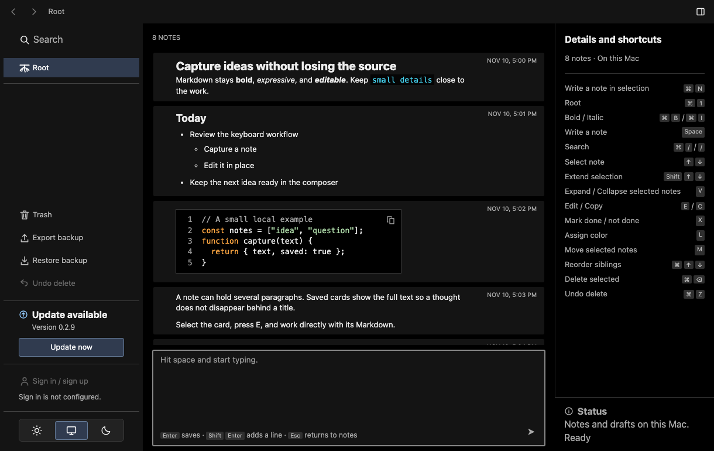
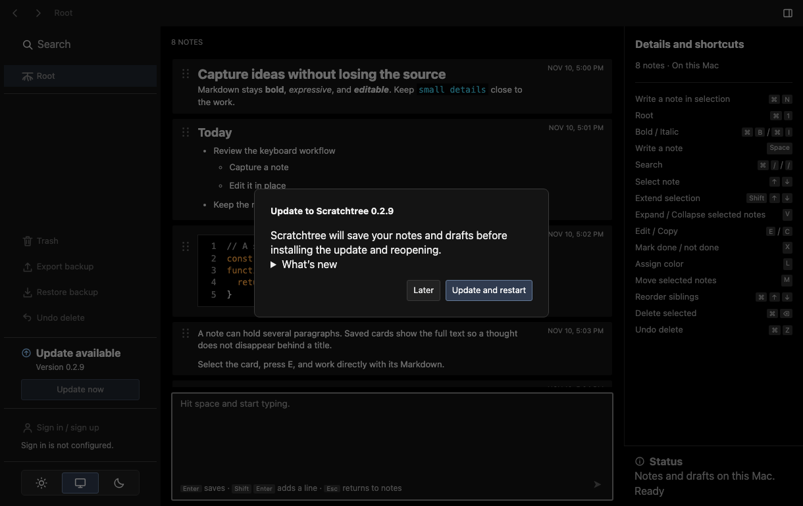
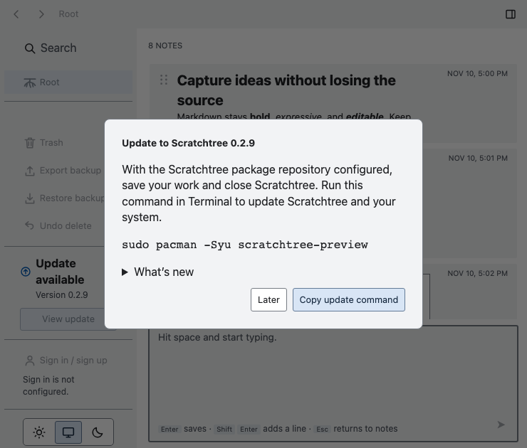

# Scratchtree prereleases

Publish the Apple Silicon DMG and the Arch Linux x86_64 Preview package as separate assets on every GitHub prerelease. Build both from the same reviewed release commit, and verify both before publication. Version 0.3.2 introduces update checks for direct-download Mac builds. Keep manual installer downloads available for both platforms. State the behavior of the exact installer being released. The Apple Silicon DMG includes private-account Dexie Cloud synchronization. The retained alpha.5 installer uses local notes only. [README.md](../README.md#download-and-install) is the installation guide for the current public downloads.

The Mac download for [v0.2.8](https://github.com/Barbacoa08/scratchtree/releases/tag/v0.2.8) is the first public Developer ID-signed and notarized DMG. Earlier public Mac DMGs contain ad-hoc signed apps. Follow the Developer ID path for current direct distribution.

The Mac release identifier is `tech.barbajoe.scratchtree`. App data is stored separately from the bundle. Use a deliberate private backup and transfer plan before testing on actual notes. The procedure below covers direct distribution through GitHub and the website. Future Mac App Store distribution has its own requirements and is tracked in [DISCUSSIONS.md](../DISCUSSIONS.md#mac-app-store-distribution).

## Scope and prerequisites

- Follow [CONTRIBUTING.md](../CONTRIBUTING.md), including independent reviews, verification, and source identity. Packaging is not a replacement for implementation acceptance.
- Confirm current authorization for the private work being performed, including use of signing credentials and submission to Apple. A private candidate can be prepared and tested ahead of a publication decision. Verify publication authorization at the [publication step](#release-notes-upload-and-publication).
- Use the README's pinned Node, pnpm, and Rust versions, macOS command-line build prerequisites, the `aarch64-apple-darwin` Rust target, Python 3 for the checks below, and authenticated GitHub CLI access to `Barbacoa08/scratchtree`. Select the toolchains in the shell before running Tauri's child commands. Do not depend on another worktree's ignored toolchain/cache paths.
- Start from a clean, freshly fetched, verified release commit, normally merged `origin/main`, in an isolated worktree. Record commit/tree IDs, tool versions, architecture, commands, outcomes, and omissions in a dated ignored `.projects/` task folder.
- Never use an original third-party application profile or bundle personal notes, IndexedDB/SQLite profiles, backups, exports, private captures, credentials, or scratch directories. New installations start empty. Do not launch against an existing user profile merely to package the installer.
- For Developer ID signing, use the authorized signing Mac with a valid **Developer ID Application** identity and its matching private key in Keychain. Select the exact identity from `security find-identity -v -p codesigning`. If the trust chain is missing its intermediate, use [Apple's Developer ID intermediate guidance](https://developer.apple.com/support/developer-id-intermediate-certificate/). Keep trust settings intact.
- Keep notarization credentials in a local Keychain profile. Use `xcrun notarytool store-credentials` interactively when setting up the profile. Keep passwords, private keys, certificate requests, account identifiers, local Keychain profile names, and raw receipts out of Git, public CI output, and release assets. The documented profile and identity variables below are local inputs. [Apple's notarization workflow](https://developer.apple.com/documentation/security/customizing-the-notarization-workflow)

For a prose-only PR, documentation checks are sufficient and no new installer is needed. For a runtime release, verify the selected source under the contributor guide, and record the applicable packaged native checks and their limits. If a squash merge leaves the complete tracked tree identical to the tested PR head, retain both identities and the verified tree equality; do not imply a fresh test run occurred. Build the release afresh from the selected clean commit.

## Build and stage an immutable application

The shell examples assume the repository root and one continuing shell. Keep error checking enabled so a failed build cannot fall through to packaging a cached artifact. Choose an explicitly approved, unused release tag before running them; the example below uses `v0.2.0`. Never overwrite an existing tag or release asset. Check the actual release list first.

```sh
set -eu
umask 022
gh release list --repo Barbacoa08/scratchtree
release_tag='v0.2.0' # Use the explicitly approved, unused version.
release_signing=developer-id # Use ad-hoc only for an explicitly authorized ad-hoc build.
# Keep GitHub's prerelease flag while the application remains in alpha.

git fetch origin --prune
test -z "$(git status --porcelain)"
release_commit=$(git rev-parse HEAD)
test "$release_commit" = "$(git rev-parse origin/main)"
release_dir=$(mktemp -d "$PWD/.projects/$(date +%F)-mac-release-XXXXXX")
git rev-parse HEAD 'HEAD^{tree}' > "$release_dir/source-identity.txt"
node --version > "$release_dir/tool-versions.txt"
pnpm --version >> "$release_dir/tool-versions.txt"
rustc --version >> "$release_dir/tool-versions.txt"
cargo --version >> "$release_dir/tool-versions.txt"

pnpm install --frozen-lockfile
release_target_dir=$(python3 -c 'import os; from pathlib import Path; print(Path(os.environ.get("CARGO_TARGET_DIR", "src-tauri/target")).resolve())')
env -u TAURI_CONFIG -u APPLE_SIGNING_IDENTITY -u APPLE_CERTIFICATE \
  -u APPLE_CERTIFICATE_PASSWORD -u APPLE_ID -u APPLE_PASSWORD -u APPLE_TEAM_ID \
  CARGO_TARGET_DIR="$release_target_dir" \
  pnpm exec tauri build --ci --no-sign --bundles app --target aarch64-apple-darwin \
  > "$release_dir/build-app.log" 2>&1

test -z "$(git status --porcelain)"
mkdir "$release_dir/staging" "$release_dir/assets"
release_app="$release_dir/staging/Scratchtree.app"
ditto "$release_target_dir/aarch64-apple-darwin/release/bundle/macos/Scratchtree.app" "$release_app"
case "$release_signing" in
  developer-id)
    : "${release_identity:?Set the fingerprint of the verified local Developer ID Application identity}"
    codesign --force --sign "$release_identity" --options runtime --timestamp "$release_app"
    ;;
  ad-hoc)
    codesign --force --sign - --timestamp=none \
      --identifier tech.barbajoe.scratchtree "$release_app"
    ;;
  *) exit 1 ;;
esac
codesign --verify --deep --strict --verbose=2 "$release_app"
codesign --display --verbose=4 --requirements - "$release_app" > "$release_dir/app-signature.txt" 2>&1
ln -s /Applications "$release_dir/staging/Applications"
```

`--no-sign` skips Tauri's signing step. Sign only the staged copy with the selected method. For Developer ID, verify the expected team and authority, secure timestamp, Hardened Runtime, and designated requirement. If future bundles introduce nested executable code, sign it inside out before sealing the outer app. The checked-in `tauri:build` command produces the app bundle. Ordinary `tauri:dev` and `tauri:preview` commands use the Preview override. A disposable probe requires its own authorized identity.

Read `Contents/Info.plist` and confirm product name, bundle identifier, executable, and internal version against the selected source configuration. Run `lipo -archs` on that executable and require `arm64`. Record `vtool -show-build` output; do not claim an older macOS version is supported merely because the plist lists it. Record every staged bundle file's relative path and SHA-256, and inspect its complete contents, including symlinks, against the expected application resources. Never copy a running app's data directory into staging. The staging root must contain only the application and the `/Applications` symlink.

Release tag and internal application version are different identities: alpha.1 and alpha.2 used internal version `0.1.0`. Read and disclose the actual values rather than silently changing source while packaging. A version/configuration change belongs in a reviewed source change before the release build.

## Native Keychain access

WebKit protects persisted WebCrypto keys with an application-bound Keychain master key. A separate database or webview store does not isolate that key from other executables using the same application identity. Keep disposable probes out of both the release identity and ordinary Preview identity (`tech.barbajoe.scratchtree.preview`); a different probe identity needs explicit authorization. Never delete a master key or reset Keychain to make a build appear to pass.

Record the packaged build's designated requirement with `codesign -d -r-`. Ad-hoc builds can have different requirements after rebuilding, so a valid seal does not establish continued access to existing keys. Native OTP, key persistence, and relaunch checks remain separate release gates. Stable signing credentials and notarization still require their own authorization. [Apple code-signing guidance](https://developer.apple.com/library/archive/technotes/tn2206/) explains identity tracking.

If macOS requests Keychain access, identify the exact requesting build and item before advising the user. **Allow** authorizes an access; **Always Allow** adds that app to the relevant operation's trusted list and persists beyond one sign-in. It does not authorize every app. Never request the user's password through chat or promise an exact prompt count. Stop if the same request repeats after a persistent grant, or the requester or item differs from the verified one; investigate without removing protection. See [Apple's access-control documentation](https://developer.apple.com/documentation/security/access-control-lists).

## Package and inspect the DMG

```sh
release_label=${release_tag#v}
release_name="Scratchtree_${release_label}_aarch64.dmg"
release_dmg="$release_dir/assets/$release_name"
test ! -e "$release_dmg"
hdiutil create -volname 'Scratchtree' -fs HFS+ \
  -srcfolder "$release_dir/staging" -format UDZO -imagekey zlib-level=9 \
  "$release_dmg" > "$release_dir/create-dmg.log" 2>&1
if [ "$release_signing" = developer-id ]; then
  codesign --sign "$release_identity" --timestamp "$release_dmg"
  codesign --verify --strict --verbose=2 "$release_dmg"
  codesign --display --verbose=4 "$release_dmg" > "$release_dir/dmg-signature.txt" 2>&1
fi
```

### Notarize and staple the Developer ID DMG

Confirm the outer DMG signature has the expected Developer ID authority, team, and timestamp. Retain a pre-notarization hash to identify the exact bytes uploaded to Apple. Set `release_notary_profile` to the name of the authorized local Keychain profile outside this guide. Each new signed DMG needs its own notarization. The certificate and profile can be reused while valid.

```sh
test "$release_signing" = developer-id
: "${release_notary_profile:?Set the local notarization Keychain profile name}"
shasum -a 256 "$release_dmg" > "$release_dir/pre-notarization-sha256.txt"
test ! -e "$release_dir/notary-submission.json"
xcrun notarytool submit "$release_dmg" --keychain-profile "$release_notary_profile" \
  --output-format json > "$release_dir/notary-submission.json"
```

Keep the submission receipt. Apple processes uploads asynchronously. Check the existing submission if waiting times out. If an upload result is unclear, check history before considering another submission. A different build can be submitted separately while a prior build is pending. Review Apple's log and resolve any signing warnings before continuing. Keep all receipts and logs in the ignored release task folder.

```sh
release_submission=$(plutil -extract id raw "$release_dir/notary-submission.json")
xcrun notarytool wait "$release_submission" --keychain-profile "$release_notary_profile" \
  --timeout 20m --output-format json > "$release_dir/notary-result.json"
xcrun notarytool log "$release_submission" "$release_dir/notary-log.json" \
  --keychain-profile "$release_notary_profile"
test "$(plutil -extract status raw "$release_dir/notary-result.json")" = Accepted
```

After reviewing the log, staple the ticket to the same signed image. Compute the publication checksum from the final stapled file. Keep that file private through acceptance.

```sh
shasum -a 256 -c "$release_dir/pre-notarization-sha256.txt"
xcrun stapler staple "$release_dmg"
xcrun stapler validate "$release_dmg"
codesign --verify --strict --verbose=2 "$release_dmg"
spctl --assess --type open --context context:primary-signature --verbose=4 "$release_dmg"
```

### Inspect the exact final image

For the Developer ID path, require the stapled ticket and a Gatekeeper assessment of **Notarized Developer ID**. For both signing methods, verify the final image on a read-only mount.

```sh
hdiutil verify "$release_dmg" > "$release_dir/verify-dmg.log" 2>&1

release_mount="$release_dir/verify-mount"
mkdir "$release_mount"
release_mounted=false
release_cleanup() {
  if [ "$release_mounted" = true ]; then
    hdiutil detach "$release_mount" || return 1
    release_mounted=false
  fi
  if [ -d "$release_mount" ]; then rmdir "$release_mount"; fi
}
trap 'release_cleanup' EXIT
trap 'exit 1' HUP INT TERM
hdiutil attach -readonly -noautoopen -nobrowse \
  -mountpoint "$release_mount" -plist "$release_dmg" \
  > "$release_dir/attach-result.plist"
release_mounted=true
```

The trap detaches the successfully attached image if a later check exits or is interrupted. Keep it active through inspection. Equivalent verification scripts must use a cleanup/finally guard. If detachment fails, stop, retain the mount context, and resolve it without forcing unmounts. Check the returned mount point before reading it. Verify all of the following before uploading any release assets to GitHub:

1. The volume contains only the expected app, Applications shortcut, and ordinary filesystem metadata. The shortcut is a symlink to `/Applications`.
2. The mounted app's complete file/symlink inventory matches staging, and all file hashes equal the recorded signed manifest. Check identifier, internal version, executable, and arm64 architecture again on the mounted app.
3. `codesign --verify --deep --strict` succeeds on the mounted application. For a Developer ID build, assessment of the mounted app must also report **Notarized Developer ID**.
4. There are no bundled notes, profiles, databases, exports, backups, credentials, or unrelated artifacts.
5. The image is detached successfully. Never leave a failed verification mount behind or upload after a failed check.

```sh
codesign --verify --deep --strict "$release_mount/Scratchtree.app"
if [ "$release_signing" = developer-id ]; then
  spctl --assess --type execute --verbose=4 "$release_mount/Scratchtree.app"
fi
release_cleanup
trap - EXIT HUP INT TERM
shasum -a 256 "$release_dmg" > "$release_dir/final-dmg-sha256.txt"
```

`hdiutil` may print deprecation notices on newer macOS versions. Record actual tool behavior and validate an alternative before changing the process.

### Accept the private Developer ID candidate

Use an isolated Mac environment and synthetic data. Test a fresh private download of the final image and compare its SHA-256 with `final-dmg-sha256.txt` before installation. Keep normal macOS security settings and download quarantine intact. Check the Applications install and first launch. macOS may show its standard Internet download confirmation. A Gatekeeper block requiring a System Settings exception fails the Developer ID acceptance check. Keep managed-device restrictions separate from the normal launch result. [Apple's opening guidance](https://support.apple.com/en-us/102445)

For the first signed release, also replace the exact supported ad-hoc build in an isolated profile using the designated test account. Export a safety backup before replacement. Record the build identities and designated requirements, Keychain prompts, saved sign-in, local notes and drafts, sync, and an offline relaunch. Verify signed-to-signed update continuity on subsequent releases. Package checks alone cannot establish launch or retained account access. Keep the candidate private until applicable acceptance passes and publication is authorized.

## Stage the Arch Linux x86_64 Preview

Dispatch [Arch Preview](../.github/workflows/arch-preview.yml) on the verified `main` release commit. Check the selected run’s event, branch, successful conclusion, and exact head SHA. Download the successful package and smoke artifacts for that run and attempt into the release task folder. Compare the recorded source commit and tree with the Mac build’s `source-identity.txt`. If `main` advances before dispatch and there is no successful run for the selected release commit, review the new `main` source and build both installers from it before staging.

Verify the package’s SHA-256 against its CI manifest and inspect the package metadata for `scratchtree-preview`, `x86_64`, and the release’s internal application version with the recipe’s Arch package revision. Review the smoke log for offline desktop launch, save and edit, and restart with exact Markdown. Check the workflow log for package installation and removal. Copy the verified `scratchtree-preview-<version>-<pkgrel>-x86_64.pkg.tar.zst` into `$release_dir/assets` and record the run URL and evidence in the release notes. Confirm that the exact source used for this build applies the Preview override with identifier `tech.barbajoe.scratchtree.preview`.

Describe Arch as an experimental signed-out Preview tested on virtual X11 with Arch WebKitGTK. The initial Preview defers native backup-dialog acceptance. Report the status of that check, Wayland, upgrades, and sync in the release notes. See the [Arch Preview guide](ARCH-PREVIEW.md) for installation and test scope.

### Stage a signed Arch repository snapshot

Use the reviewed Arch Preview package and its verified SHA-256 from CI. Use an Arch environment with GnuPG, libarchive, pacman tools, and a dedicated signing keyring. Use a separate disposable key when testing.

For the first authorized release, provision the signing key on the signing machine. [GnuPG key management](https://gnupg.org/documentation/manuals/gnupg/OpenPGP-Key-Management.html)

1. Create a separate GnuPG home with mode 0700. In that keyring, run `gpg --full-generate-key` interactively to create a dedicated signing key, and set its passphrase through the local prompt.
2. Record the full primary fingerprint from `gpg --fingerprint`. Export only that public certificate with `gpg --armor --export "$release_arch_fingerprint" > scratchtree-arch.asc`. Check that the export contains one key with the matching fingerprint.
3. Keep a secure offline backup of the signing key and its revocation certificate from `openpgp-revocs.d`. Keep release private keys and passphrases outside Git, release artifacts, and CI.

From the repository root, set `release_arch_keyring` to the absolute path of the authorized keyring. Set `release_arch_package` to the approved package path, `release_arch_sha256` to its manifest digest, and `release_arch_fingerprint` to the chosen key's full fingerprint. Use a new snapshot directory within the existing private release folder.

```sh
GNUPGHOME="$release_arch_keyring" bash packaging/arch/stage-signed-repo.sh \
  "$release_arch_package" "$release_arch_sha256" "$release_arch_fingerprint" \
  "$release_dir/arch-repository"
```

The helper checks the copied package's checksum, name, version, and architecture before signing. It verifies the detached package signature and both repository index signatures before making the completed snapshot available locally. Keep the exact package and its `.sig`, `scratchtree.db` and `scratchtree.db.sig`, and `scratchtree.files` and `scratchtree.files.sig` together. [Arch repository signing](https://man.archlinux.org/man/repo-add.8.en)

Before publishing, verify the same signed install and upgrade in a clean Arch environment, using the intended public key and configuration. A public deployment needs separate authorization. Publish immutable package files and signatures before making the new indexes available. Deploy each index with its matching signature in the same snapshot, retain packages referenced by the previous index during the transition, and verify installation from the live HTTPS URL. Publish the single public key and its full fingerprint through the official Scratchtree installation instructions. During planned rotation, announce the replacement fingerprint, verify that users can install from the newly signed snapshot, and then retire the prior key. If a key is compromised, pause publishing, publish its revocation, and tell users to remove it from pacman’s trusted keys. Enable the Arch update feed only after the repository and its trust setup have passed acceptance.

## Desktop update candidates

Mac users on 0.3.1 or earlier install the 0.3.2 DMG once to enable update checks. The first 0.3.2 feed points to its own archive, so an installed 0.3.2 does not offer an update until a newer release is advertised. The updater checks once when a configured native workspace opens. The footer appears only for a newer offer, and the user chooses when to update.

The screenshots use a browser fixture with synthetic notes and an example offer for version 0.2.9.



### Direct-download Mac updater



- Set `SCRATCHTREE_MAC_UPDATE_ENDPOINT` to `https://scratchtree.barbajoe.tech/releases/mac.json` and `SCRATCHTREE_MAC_UPDATE_PUBKEY` to the release updater public key as exported by the signer. These are build-time inputs to the direct-download Mac release channel. Keep the corresponding private key and password in approved, backed-up local storage. The Developer ID certificate and Apple notarization remain separate requirements. Leave update inputs unset for ordinary builds without a feed.
- After acceptance and publication authorization, publish the versioned archive on the GitHub prerelease, verify its unauthenticated download against the accepted archive, and then publish the reviewed manifest from `website/mac-update.json` through the normal website deployment. For updater-disabled releases, keep the existing two-installer workflow. The Tauri manifest includes a numeric build version, optional plain-text `notes`, and a `platforms.darwin-aarch64` entry with an exact versioned GitHub archive URL and the matching signature. The expected filename is `Scratchtree-<version>-aarch64.app.tar.gz` under the corresponding `v<version>` tag. Prepare the archive from the final Developer ID-signed app with its own notarization ticket. Validate the app again after extraction. [Tauri updater guide](https://v2.tauri.app/plugin/updater/) · [Apple notarization workflow](https://developer.apple.com/documentation/security/customizing-the-notarization-workflow)
- Package a single `Scratchtree.app` root in the gzip tar. Use ordinary files and directories with unique ASCII paths. The archive must contain exactly one `Contents/Info.plist` for the selected identity and version, and one thin arm64 `Contents/MacOS/scratchtree` executable. The installer accepts up to 128 MiB compressed and 512 MiB expanded. Check the exact archive in packaged acceptance before publication.
- Bind the signature to the exact application version. For manual signing, use `pnpm exec tauri signer sign --app-version "$release_label" "$update_archive"` with the approved local signing inputs. Sign the final archive bytes. Verify the detached signature with the same public key embedded in the prior build and preserve the DMG and its checksum separately.
- For a private A-to-B probe, build both versions with the exact disposable bundle identity `tech.barbajoe.scratchtree.updater-probe` and a separate test updater key. Set the build-time endpoint to `http://127.0.0.1:<port>/mac.json` on a non-default port, serving only the synthetic manifest and archives on loopback. Use the same version-bound signature format and the archive at `/v<version>/Scratchtree-<version>-aarch64.app.tar.gz` on that same origin. The probe refuses redirects. Use only disposable data and an isolated app installation.
- Test version and signature mismatches, blocked saves, a network interruption, and a protected installation location. Verify relaunch and note, draft, and Undo persistence in the probe. Verify Developer ID, Gatekeeper, Keychain continuity, and retained sign-in and sync separately for the notarized release build in an isolated macOS profile. Keep recovery installers and review backup compatibility before suggesting a downgrade.

### Arch Preview handoff



Set `SCRATCHTREE_ARCH_UPDATE_ENDPOINT` at build time only when the intended package repository is ready for testing. The HTTPS metadata describes `platform` as `linux-x86_64`, `package` as `scratchtree-preview`, a newer `version`, and optional plain-text `notes`. Scratchtree shows the package-manager action. The user installs through their configured pacman repository. Verify that normal system upgrades retain the package identity and existing notes and drafts. The existing Arch workflow builds with update discovery disabled. The package repository, its trust setup, and the build-time workflow configuration require separate acceptance before enabling this path publicly. [Arch Preview manual installation](ARCH-PREVIEW.md)

## Release notes, upload, and publication

Confirm publication is authorized before creating the GitHub draft and uploading any installer assets. A merged source or documentation PR does not grant publication authorization. An authorized release includes updating the public download links, reviewing and merging the metadata PR, and verifying the automatic Netlify deployment and public downloads. Complete that website handoff in the release task.

Write release notes inside the task folder. Include changes, exact source identity, actual verification/omissions, tested platform and account/synchronization limits, internal version, signing status, and installation instructions. Record the current BackupV8 contract and application identity. Earlier profiles and exports are not opened or migrated automatically. Before moving from the last pre-sync alpha.5, preserve an unchanged private BackupV7 and working recovery installer, use the separate local-only converter, validate its BackupV8 output, import it, and verify a fresh export. Keep each Mac’s distinct export until its intended data is verified. Do not bundle the converter, old reader, or actual exports in the product. Restore **replaces** the destination library and, while signed in, the shared library on every Mac. Drafts and Undo import only on that device; older offline work remains recoverable. Test native account/code persistence, offline reopen, sign-out/no-transport restart, two-client convergence, rejected-input recovery, and converted backup round trip before claiming those release features. Historical public alpha releases may be removed only under applicable task authorization and after a working recovery path exists.

Version 0.2.8 has separate checksum files. `SHA256SUMS.txt` verifies the notarized Mac DMG that replaced the original ad-hoc asset, and `SHA256SUMS-arch.txt` verifies the Arch package. New prereleases use one `SHA256SUMS.txt` covering both packages.

For an ad-hoc release, install the app in Applications, try opening it, click **Done** on the warning, then open **System Settings → Privacy & Security → Security** and click **Open Anyway**. Authenticate if prompted and confirm **Open**. Proceed only if you trust the download. Link [Apple's per-app opening instructions](https://support.apple.com/en-us/102445) and note that managed Macs may restrict opening. Do not prescribe disabling system-wide protections or removing quarantine attributes.

For a verified Developer ID release, describe the drag-to-Applications installation and the standard first-open confirmation. Document actual findings from the signed upgrade test separately from Gatekeeper. Update the public installation guidance when the signed installer is published. Keep the manual Mac download available alongside the updater. Mac App Store distribution has its own [discussion entry](../DISCUSSIONS.md#mac-app-store-distribution).

Stage only the approved files in `assets`. Set `arch_package_name` to the verified Arch package basename. For an updater-enabled release, set `release_updater_archive` to the basename of the verified signed archive, `Scratchtree-<version>-aarch64.app.tar.gz`. Keep its matching `.sig` beside it. The checksum, draft upload, and public download steps cover all selected assets.

```bash
shasum -a 256 -c "$release_dir/final-dmg-sha256.txt"
release_assets=("$release_name" "$arch_package_name")
if [ -n "${release_updater_archive:-}" ]; then
  release_assets+=("$release_updater_archive" "$release_updater_archive.sig")
fi
release_title="Scratchtree $release_label — Apple Silicon and Arch Preview"
(
  cd "$release_dir/assets"
  shasum -a 256 -- "${release_assets[@]}" > SHA256SUMS.txt
  gh release create "$release_tag" "${release_assets[@]}" SHA256SUMS.txt \
    --repo Barbacoa08/scratchtree --draft --prerelease --target "$release_commit" \
    --title "$release_title" --notes-file "$release_dir/release-notes.md"
)
draft_id=$(gh release view "$release_tag" --repo Barbacoa08/scratchtree --json databaseId --jq .databaseId)
gh api "repos/Barbacoa08/scratchtree/releases/$draft_id" > "$release_dir/draft-release.json"
gh release download "$release_tag" --repo Barbacoa08/scratchtree \
  --dir "$release_dir/download-check"
for asset in "${release_assets[@]}" SHA256SUMS.txt; do
  cmp "$release_dir/assets/$asset" "$release_dir/download-check/$asset"
done
```

Before publishing, verify the draft and prerelease flags, full target commit, exact asset names, uploaded state, byte counts, and asset digests against the local files. On failure, keep the release as a draft and resolve the issue. Use the GitHub connector where supported and the CLI for release binary transfers.

When these checks pass and publication is authorized:

```bash
gh release edit "$release_tag" --repo Barbacoa08/scratchtree \
  --draft=false --prerelease --latest=false
gh api "repos/Barbacoa08/scratchtree/releases/tags/$release_tag" \
  > "$release_dir/published-release.json"
git ls-remote --tags origin "refs/tags/$release_tag" "refs/tags/$release_tag^{}" \
  > "$release_dir/published-tag.txt"
mkdir "$release_dir/public-download"
for asset in "${release_assets[@]}" SHA256SUMS.txt; do
  curl --fail --location --silent --show-error \
    --output "$release_dir/public-download/$asset" \
    "https://github.com/Barbacoa08/scratchtree/releases/download/$release_tag/$asset"
  cmp "$release_dir/assets/$asset" "$release_dir/public-download/$asset"
done
(cd "$release_dir/public-download" && shasum -a 256 -c SHA256SUMS.txt)
```

Confirm public metadata has `draft: false` and `prerelease: true`, the tag resolves to the exact release commit, and the public assets match the verified draft. Preserve the release URL, artifact identities, verification output, and omissions locally. If post-publication checks fail, resolve the issue within the current authorization and preserve immutable assets and tags.

## Website links and automatic deployment (required)

A release is not complete when the GitHub assets alone are published. The release task includes the website handoff below; do not leave it for the user to request separately.

1. **Update links after publication is verified.** Update the root README's installation and release-notes links, the Arch Preview installation guide, and `website/release.json` (`version`, `downloadUrl`, `archDownloadUrl`, and `releaseUrl`) to the published tag and both packages. Show Arch users how to verify the package’s own entry in the published checksum manifest. Keep `testedOn` tied to observed platform evidence, and update other current-version guidance where necessary while preserving historical facts. Use exact tag and asset URLs. Prereleases are not reliably addressed by `releases/latest`. For an enabled Mac channel, update `website/mac-update.json` only after the public archive and signature have been verified. The feed may keep its previous version while a new installer is published.
2. **Review, check, and merge the metadata update.** Follow [CONTRIBUTING.md](../CONTRIBUTING.md): use a fresh task branch from current main, the applicable independent review, formatting and local-link checks, and `pnpm build:site`. Confirm the generated page has the intended version and links, then merge the reviewed PR into `main` as part of the authorized release. Record its merged commit separately from the immutable application release commit. A documentation-only follow-up does not require rebuilding or replacing the published app, DMG, or tag.
3. **Wait for the automatic production deployment.** The existing `scratchtree` Netlify project is linked to `Barbacoa08/scratchtree` through the Netlify GitHub App. Confirm builds are active on production branch `main`, with the checked-in `netlify.toml` using `pnpm build:site`, `website/dist`, and `netlify/functions`. After the merge, wait for the Git-triggered production deploy to finish, and verify that its source commit matches the merged metadata commit and that it is the currently published deploy. A deploy preview, an older successful deploy, or a manual CLI upload does not establish this automatic merge-to-production path. A routine release should not need a manual upload.
4. **Verify the public result and actual download.** Fetch both [scratchtree.barbajoe.tech](https://scratchtree.barbajoe.tech/) and [scratchtree.netlify.app](https://scratchtree.netlify.app/). Check that the pages show the intended release, their download and release-notes links match the published assets, and the static asset hashes match the reviewed local site build. Follow every installer link extracted from the live page, require a successful unauthenticated download for each, and compare each downloaded installer’s byte count and SHA-256 with the verified release artifacts and its published checksum manifest. For the Mac channel, also compare the live `/releases/mac.json` bytes with the reviewed build, confirm `Cache-Control: no-cache`, verify the referenced archive and detached signature without credentials, and confirm the installed version only offers strictly newer releases. Preserve the existing account-check function and private server settings; check native-origin preflight and a synthetic unknown-account response without reading or transmitting private allow-list entries or sending an OTP. Separate real-account acceptance remains subject to its existing authorization and evidence requirements.
5. **Record completion or resolve the failure.** Record the release URL, metadata PR/merged commit, Netlify deploy ID/source commit, public page/link results, and download checksum in the task evidence and final handoff. Do not report the full release complete until the GitHub publication, merged links, automatic production deployment, and live download checks all pass. If the automatic deployment fails or the page stays stale, inspect the build, repository connection, and published commit, and resolve the existing pipeline within the authorized scope. If a required permission or external blocker prevents completion, report the exact unfinished gate. Keep immutable release assets and tags unchanged while diagnosing website failures.

Never advertise synchronization, automatic updates, notarization, or wider platform support that the released build does not provide.

## Web editor deployment

The free editor has its own Netlify production project, `scratchtree-web`, at [app.scratchtree.barbajoe.tech](https://app.scratchtree.barbajoe.tech/). Use `scratchtree-web-staging` for isolated HTTPS acceptance with synthetic data. The landing site keeps its own project and desktop download workflow.

1. Run `pnpm build:public-web` from the reviewed commit. Record `git rev-parse HEAD` and the `release` value in `public-web-dist/app-release.json` separately. Upload only `public-web-dist/`, including `_headers`, to `scratchtree-web-staging`. For a Git-connected build, use [the app's Netlify configuration](../deploy/web/netlify.toml), repository root as the build base, and `deploy/web` as the package directory. Keep Pretty URLs disabled so Netlify serves the reviewed shell bytes.
2. On staging, compare the shell and manifest to the artifact, verify MIME types, the Content Security Policy, and cache headers, and test offline reopening, local edits, a same-release update check, and BackupV8 export and restore. Use `pnpm test:public-web` for the two-release update test on loopback. Cover actual Chrome and Safari on Apple Silicon. Record VoiceOver navigation and focus checks separately from browser automation. Keep staging and production in separate browser profiles or test origins, and use only synthetic notes.
3. With production deployment authorized, publish the same verified artifact bytes to `scratchtree-web`. Verify trusted HTTPS on the canonical host and confirm that it serves the expected release and can prepare for offline use. The canonical origin preserves the established browser storage. Verify it before publishing a landing-page link, then check the live landing page's **Open web app** action and desktop download links.
